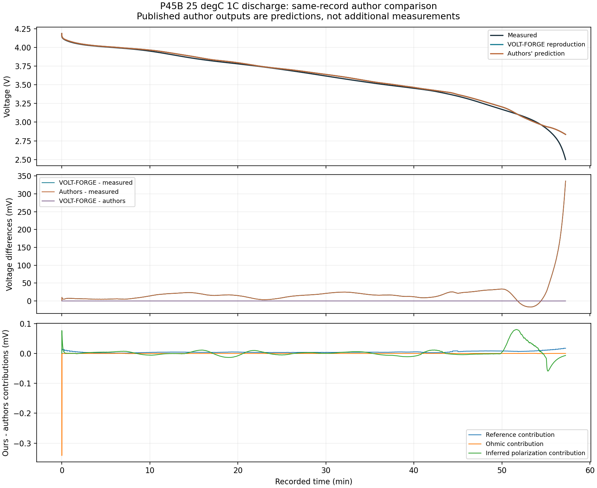
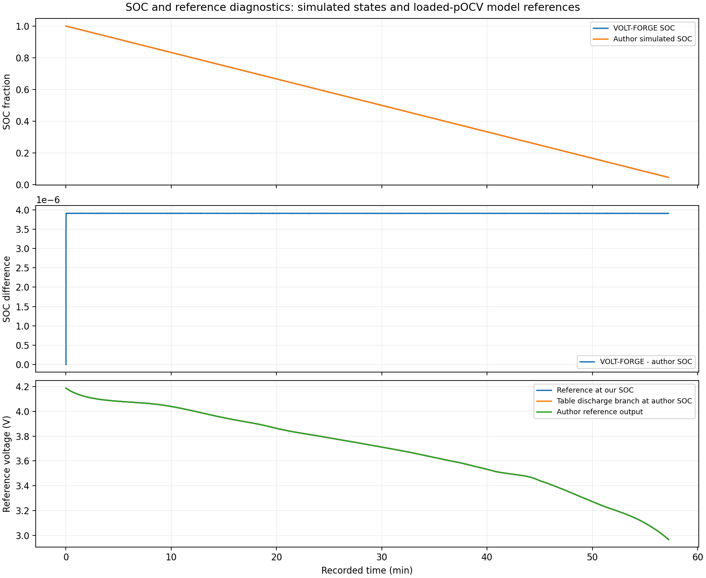

# Same-record P45B author comparison

**VOLT-FORGE closely reproduces the authors' published voltage prediction for
this discharge. The approximately 336 mV final voltage error is also present
in the authors' prediction.** It is not explained by the small differences
between our implementation and their released output on this record.

This narrows the investigation from a possible reproduction mismatch to why
this published parameterization misses this measured discharge near empty.
It does not identify the physical cause or establish module accuracy.

## Scope and provenance

The [procedure](PROCEDURE.md) was committed as `1d53403` before author-output
access. The implementation, exact source lock and 15 passing synthetic checks
were committed as `be2243d` before the first real author comparison. The full
focused suite now passes **74 tests**. No model code, fitted parameter, initial
condition, measurement, existing run or time alignment was changed.

Only the six author-output fields in the already-used
`MOLICEL_P45B_025degC_1C_Dch.csv` family were newly interpreted. They are predictions,
not new measurements. All 3,433 rows have complete author values and join exactly
to the saved primary reproduction by source line, timestamp and measured channels.
The same-sample comparison covers the whole 3,433.786 s record. No cutoff trimming,
voltage offset or calibration was used. The other 50 archive members, alternate
charge table and validation workbook remain unopened.

The original [reproduction decision](../p45b_reproduction_v1/DECISION.md) and
its 35.86 mV/336.04 mV result remain preserved. This report resolves its specific
question about agreement with the authors' implementation. Exact source hashes,
frozen artifact references and current implementation hashes are recorded in
[summary.json](run_001/summary.json). Every derived CSV row retains its source line.

## Voltage comparison on identical samples

| Difference | Sample RMSE (mV) | Time RMSE (mV) | Sample bias (mV) | Maximum absolute difference (mV) |
|---|---:|---:|---:|---:|
| VOLT-FORGE minus measurement | 35.86039 | 35.03408 | +19.07141 | 336.03857 |
| Authors minus measurement | 35.85888 | 35.03259 | +19.06386 | 336.02790 |
| VOLT-FORGE minus authors | **0.01830** | **0.01806** | +0.00754 | **0.25101** |

The small prediction-to-prediction difference is a reproduction result. It must
not be quoted as voltage accuracy against a real cell. The identical-sample and
all-available masks coincide here; the implementation also reports them separately
and tests missing-value handling without bridging missing points or large gaps.

At the final sample (source line 3,434, 3,433.786 s):

| Quantity | Value |
|---|---:|
| Measured voltage | 2.499487735 V |
| Authors' voltage | 2.835515634 V |
| VOLT-FORGE voltage | 2.835526306 V |
| Authors' simulated SOC | 0.046174187 |
| VOLT-FORGE calculated SOC | 0.046178093 |

The measured channel first crosses the 2.5 V test-protocol cutoff at source
line 3,433 (3,433.758 s). Neither prediction crosses it within the record.
The device's actual voltage limit and excursion duration remain
**requirement not configured**; 2.5 V is not being adopted as that requirement.

## What explains the small implementation differences

The first state matches: SOC=1, reference 4.187529996 V and terminal voltage
4.187509733 V. Both temperature channels are 25 degC throughout. The maximum
SOC difference is 3.9121e-6 of full charge (0.00039121 percentage points).
The authors' SOC agrees with a trapezoidal integral of **experimental current**
and nominal 4.5 Ah to within 3.36e-9 SOC. Our frozen primary uses left-held
current; its expected small offset is about 3.91e-6 SOC. This supports a sampling-
convention explanation for that offset, not a different usable capacity or a
need to adjust starting SOC. It does not prove the authors' internal solver settings.

The maximum terminal prediction difference occurs at the initial load transition,
source line 3 at 0.025 s. Experimental current is -4.48530 A while the released
interpolated author current is -4.43669 A. Our-minus-author ohmic contribution is
-0.34146 mV, with +0.07670 mV from the inferred polarization difference and a
small reference contribution, giving -0.25101 mV total. The format guide explains
that disclosed simulated current can differ due to output interpolation. We
retain the measured input; no channel is changed to force agreement.

At the **same author SOC**, the published table's discharge reference differs
from the author's E_OCV_V by at most **0.00346 mV**. With our SOC coordinate, the
reference difference is at most **0.01732 mV**. The largest inferred polarization
contribution to ours-minus-author voltage is **0.08012 mV**. The three-term
reference/ohmic/polarization decomposition closes within 1.20e-12 mV numerically.
The author's polarization is an algebraic remainder, not a disclosed pair of RC
states or a measured polarization voltage.

These checks support the implemented sign, nominal capacity, state evolution and
reference convention on this one unidirectional profile. They do not establish
hysteresis accuracy under reversal, thermal behaviour, different temperatures,
higher-current pulses or module current sharing.

## Separate data-definition discrepancy

The supplied *Data Format Documentation*, PDF page 2, calls `Q_sim_W` predicted
cell power and specifies negative power for discharge. That definition was
visually rechecked after the numerical diagnostic failed.

In this record Q_sim_W is positive, between 0.0000308357 and 1.239714565 W.
At the final sample, `I_sim_A * V_sim_V = -12.759833132 W`, while
`Q_sim_W = +1.239714565 W`. The RMSE of `Q_sim_W - I_sim_A*V_sim_V` is 16.8293 W.
This is a confirmed inconsistency between the documented signed electrical-power
interpretation and the released values. The channel could have another intended
meaning, but that is an unresolved hypothesis; we do not relabel it as heat.

Q_sim_W is retained with its original name and author-prediction label, marked
semantically unresolved in this report. It is not an input to either our voltage
model or this voltage comparison, and must not be used as validated delivered
power or heat generation. No thermal model has been added. The precise unsent
clarification is in [AUTHOR_QUESTIONS.md](AUTHOR_QUESTIONS.md).

## Confirmed, unresolved and next action

Confirmed: the published author prediction contains the same low-SOC voltage
miss as our reproduction. Minor numerical/current-output differences are far
too small to explain it. No reference extension is involved. The result remains
a single known development profile using already-published parameters.

Unresolved: whether the miss reflects differences in preparation or individual
cells, the loaded reference/SOC origin, nominal versus effective capacity, or
low-SOC limitations of the parameterization. Agreement between two implementations
does not prove any of these physical explanations. The present constant-current
record cannot separate them or establish parameter uncertainty.

Keep the existing P45B reproduction frozen. The next bounded development step
should inspect the already-proposed **25 degC C/30 discharge and GITT discharge**
families under a new predeclared procedure, examining low-SOC reference support,
charge accounting and relaxation before any model revision. Do not add RC elements
or fit capacity merely to erase this residual. Those files are available locally,
so this diagnostic work does not require lab access. They have **not** been opened
in this stage.

Four-cell experimental validation still needs preparation, calibration, channel
timing/mapping, voltage-sense and branch-current evidence. The new single-cell
finding does not resolve the LG current-conservation discrepancy or validate a
FreeTwinEV module model. The nine unused LG cells, 13 unused FreeTwinEV records,
frozen module outcomes and all raw sources are preserved. No outreach was sent.

## Plots, attribution and commands





Source: Dickinson et al., About:Energy (2026), Molicel P45B ECM release,
[Zenodo DOI 10.5281/zenodo.19052626](https://zenodo.org/records/19052626),
[CC BY 4.0](https://creativecommons.org/licenses/by/4.0/). The licence/checksum
evidence is preserved in [public_release.json](../p45b_intake_v1/public_release.json).
This directory adds diagnostic differences, inferred polarization, summaries
and plots to one public profile. Source author outputs retain their labels;
they are not presented as VOLT-FORGE predictions or as observations. Original
downloads and the separately supplied paper are not redistributed. No author
endorsement is implied.

From the repository root, choose new output paths:

```powershell
& C:\Users\DELL\anaconda3\python.exe scripts\ae_p45b_author_comparison.py --out tmp\p45b_author_comparison_repeat
& C:\Users\DELL\anaconda3\python.exe -m pytest tests\test_ae_p45b_author_comparison.py tests\test_ae_p45b_reproduction.py tests\test_ae_p45b_equations.py tests\test_ae_p45b_intake.py -q
& C:\Users\DELL\anaconda3\python.exe scripts\verify_p45b_author_comparison.py --out tmp\p45b_author_comparison_verification.json
```

For a student: our software reproduces what the published model predicts. Both
predict too much voltage near empty in this test. The next job is to understand
the model's low-charge behaviour using the available characterization data, not
to treat reproducing the authors' answer as proof that the answer matches reality.
