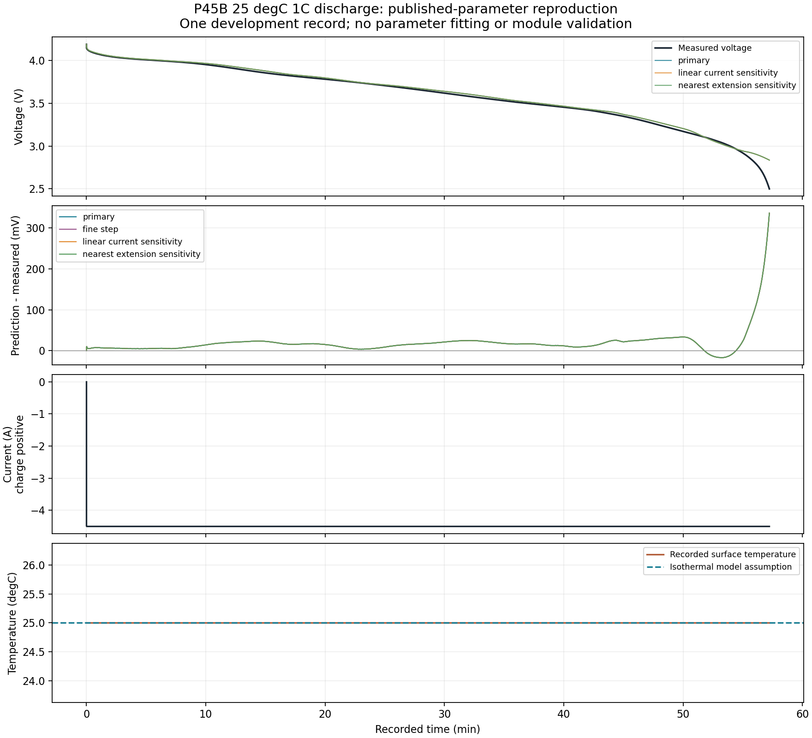
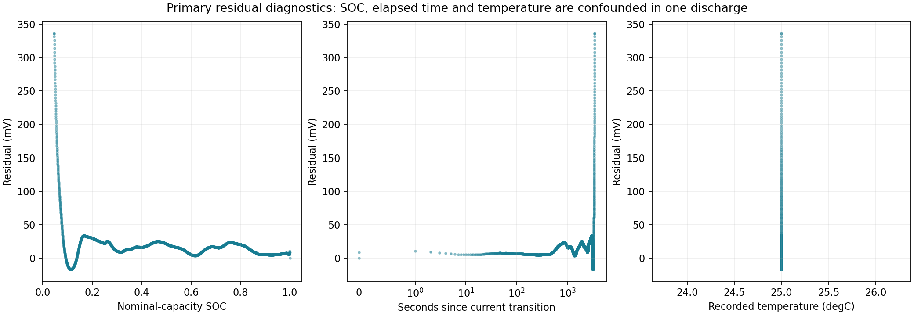

# P45B 25 degC discharge reproduction decision

The published-parameter implementation now runs end to end against one declared
development discharge. **Full-record voltage RMSE is 35.86 mV, with a positive
bias of 19.07 mV and a maximum error of 336.04 mV near discharge termination.**
This supports continued diagnosis, not P45B module deployment or voltage-limit
decisions. The frozen LG v2 model and editor physics remain unchanged.

## Allocation, procedure and implementation

The [procedure](PROCEDURE.md) was committed as `af8d64f` before opening numerical
parameter rows or this measurement record. The implementation, source lock and
57 passing synthetic checks were committed as `8c2dd73` before the first real
measurement run. Only the base fitted parameter table and the complete
`MOLICEL_P45B_025degC_1C_Dch.csv` development family were released.

The first calculation reached report export but failed on a NumPy boolean in JSON.
Its partial [run_001](run_001/attempt_status.json) is retained and labelled failed.
The fix changes serialization only. All four prediction CSVs, source diagnostics
and table audit are **byte-identical** between that attempt and completed
[run_002](run_002/summary.json). No model assumption was adjusted after seeing
the result. The original 57-test receipt remains preserved; the final suite has
**59 passing tests**, including complete synthetic CLI export and overwrite refusal.

This is a reproduction using published fitted parameters on an authors' published
validation profile. It is neither new identification nor a fresh independent
assessment of those parameters. The authors' simulation fields were not converted
or used, and the validation workbook remains unopened. Thus we have not yet
established agreement with the authors' particular simulator or reported metric.

## What the record actually covers

| Quantity | Observed or declared value |
|---|---|
| Experimental samples | 3,433, source CSV lines 2-3,434 |
| Recorded interval | 0-3,433.786 s, about 57.23 min |
| Sustained discharge after initial sample | 3,433.761 s, approximately 4.4853-4.5002 A |
| Sampling interval | Median 1 s; minimum 0.025 s; maximum 1.027 s; no declared acquisition gap |
| Recorded voltage | 4.187263 down to 2.499488 V |
| Recorded temperature channel | Exactly 25 degC throughout |
| Integrated discharge charge, left-held input | 4.292199 Ah; a calculation from this record, not a replacement nominal capacity |
| Assumed initial state | SOC=1, h=-1, both RC voltages zero |
| Model capacity and temperature | Nominal 4.5 Ah; isothermal 25 degC |
| Calculated SOC range | 1 down to 0.0461781 |
| 25 degC lookup support | -0.00579559 to 1; no extension used |

The experimental temperature channel's constant value does not demonstrate a
uniform internal temperature or identify thermal behaviour. The initial state
is the paper's reproduction convention, not measured SOC. Source current is
preserved as charge-positive; the separately named discharge-positive column
does not replace or rescale it. Minimal cumulative-current accounting reproduces
the simulated SOC to floating-point precision; the receipt records the difference.

The base table has 839 rows, including 210 at 25 degC. SOC knots are explicitly
sorted for interpolation; measurement rows are never sorted or repaired. All
four temperature slices have monotone reference branches and ordered RC time
constants at their knots. The 25 degC time constants span about 3.93-4.59 s and
33.22-80.32 s. Q_Ah agrees with `4.5*(SOC-1)` within 4.45e-15 Ah. Table values
are unchanged; only the exact 25 degC slice is used. See [table audit](run_002/table_audit.json)
and [record diagnostics](run_002/source_diagnostics.json).

## Predeclared comparison

All four runs cover all 3,433 samples and 3,433.786 s. Errors are predicted minus
measured voltage. Time metrics use trapezoidal weights at the actual timestamps.

| Run | Sample RMSE (mV) | Time RMSE (mV) | Sample bias (mV) | Maximum absolute error (mV) |
|---|---:|---:|---:|---:|
| Primary, 0.25 s maximum substep | 35.860 | 35.034 | +19.071 | 336.039 |
| Fine step, 0.0625 s | 35.862 | 35.036 | +19.070 | 336.043 |
| Linear-current sensitivity | 35.857 | 35.030 | +19.066 | 336.022 |
| Explicit nearest-extension sensitivity | 35.860 | 35.034 | +19.071 | 336.039 |

The fine-step run differs from primary by at most **0.05290 mV**, meeting the
predeclared 0.1 mV numerical-convergence check. This criterion is not an accuracy
requirement. Linear versus left-held current changes predicted voltage by at most
**0.09027 mV**. No SOC extension was needed, so the nearest-extension run is
identical to primary. These checks do not explain the end-of-discharge discrepancy.
They are sensitivity scenarios, not confidence intervals.

The measured channel first crosses the paper's 2.5 V discharge cutoff near the
end. The prediction does not cross it within the available record. The common
pre-cutoff prefix still has 34.94 mV sample RMSE and 331.53 mV maximum error.
The full-record result remains primary; excluding two final samples does not
resolve the discrepancy. This cutoff belongs to the characterization protocol.
The actual application's voltage limit and excursion duration remain
**requirement not configured**.

## Residual diagnosis and limits

| Predeclared nominal SOC region | Samples | Sample RMSE (mV) | Bias (mV) | Maximum absolute error (mV) |
|---|---:|---:|---:|---:|
| 0.8-1 | 721 | 9.65 | +8.47 | 20.32 |
| 0.2-0.8 | 2,157 | 18.02 | +16.97 | 29.85 |
| 0-0.2 | 555 | 81.06 | +41.02 | 336.04 |

These bins were declared before access. The central region must not replace the
whole-record headline or be treated as a newly validated operating domain.
The full [summary](run_002/summary.json) also reports current, transition-time
and recorded-temperature groups with counts and adjacent-sample durations.

Confirmed observations: first-sample voltage differs by only +0.247 mV; most of
the discharge has positive residual; the final simulated voltage is 2.835526 V
against measured 2.499488 V. The large late error occurs inside the table's SOC
domain. It is not caused by reference extrapolation. SOC and elapsed time vary
together, current is nearly constant, and recorded temperature has no variation.
Those correlations do not identify a physical cause. There is no substantial
relaxation or reversal segment here: hysteresis remains -1 and this record cannot
identify gamma or independently separate the reference, initial SOC, capacity
and RC contributions.

Tested explanations: a four-times smaller step and a different input integration
convention have negligible effects relative to the observed discrepancy. Current
polarity, Ah-to-coulomb conversion, table column mapping, analytical RC/hysteresis
responses, reference support, and a synthetic variable-parameter trajectory
against an independent SciPy ODE solution are checked. No measurement was rescaled.

Unresolved hypotheses: a mismatch in the reproduction/reference convention,
record preparation or effective SOC origin, differences between the characterized
cells, and limitations of the published fitted functions at low SOC. None is
established by this run. Reducing nominal capacity to the integrated endpoint
charge or fitting starting SOC to remove the discrepancy would be an undeclared
change and has not been done. Parameter uncertainty is not supplied by the
published table and is not inferred from this single record.

## Plots and source attribution





Both figures and the four comparison CSVs derive from the named source member
above; its SHA256 and original row references are in `summary.json` and each
CSV. Predicted fields and residuals are VOLT-FORGE calculations. Measured fields
retain their original units and values. See [attribution and licence](ATTRIBUTION.md).

## Decision and next action

The bounded reproduction is complete and preserved. **Do not enable P45B module
predictions or voltage-limit decisions from this result.** The next useful step
is a separately declared diagnostic comparison with the authors' predicted
voltage/SOC/reference columns for this **same already-used development family**.
That can separate a reproduction mismatch from an error also present in their
published prediction without consuming another measurement family. Do not tune
the model to those outputs or call them measurements.

The remaining 50 P45B archive members (42 families), charge-optimized parameter
table, validation workbook, nine LG cells and 13 unused FreeTwinEV records remain
protected. The paper, original downloads, sealed LG models and module outcomes
are unchanged. Module validation still requires suitable calibration, preparation,
sensor mapping/timing, connection/sense-location and branch-current evidence.
No lab request was sent. No repair or battery-performance improvement is claimed.

## Reproduce

From the repository root, keep the original downloads present and choose a new
output directory. The command enforces the one-record allocation and source hashes:

```powershell
& C:\Users\DELL\anaconda3\python.exe scripts\ae_p45b_reproduction.py --out tmp\p45b_reproduction_repeat
& C:\Users\DELL\anaconda3\python.exe -m pytest tests\test_ae_p45b_reproduction.py tests\test_ae_p45b_equations.py tests\test_ae_p45b_intake.py -q
& C:\Users\DELL\anaconda3\python.exe scripts\verify_p45b_reproduction.py --out tmp\p45b_reproduction_verification.json
```

For a student: the software now predicts and plots a real single-cell discharge.
It follows much of the voltage curve, but misses the sharp voltage fall near empty.
We need to explain that miss before using the model to decide when a device will
run out of voltage or how a four-cell module will share current.
